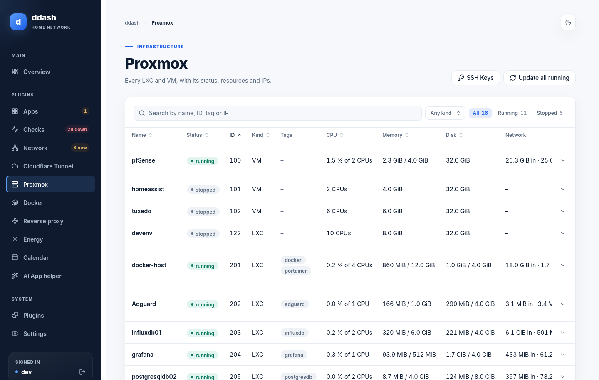

# ddash

A self-hosted admin dashboard for one home network: it shows and controls the apps, hosts, and network services running on it. It is built for one Operator, the person who runs that network.



ddash is a core plus Plugins. A Plugin adds Widgets and Pages for one system (Proxmox, Docker, pfSense and AdGuard, a reverse proxy, Cloudflare Tunnel, Checks and more). Every change it makes is an Action: shown as a Plan first when it touches another system, and recorded in the Audit Log.

## Deploy

ddash runs as one container on its own host. [`docs/deployment.md`](docs/deployment.md) is the checklist, from the LXC to the first sign-in.

## Develop

You need Go (the version in `go.mod`) and Node 24.

```sh
make install   # the pnpm workspace, once
make dev       # everything against fakelab, at http://127.0.0.1:5173
make check     # lint, generated code, tests, typecheck and the Plugin contract
```

`make dev` needs no real systems: fakelab serves recorded fixtures in their place. The `Makefile`'s comments describe every other target.

## Find your way

- [`GLOSSARY.md`](GLOSSARY.md): the words ddash uses, in code and in the UI.
- [`docs/adr/`](docs/adr): the decisions behind the architecture.
- [`docs/releasing.md`](docs/releasing.md): cutting a Release, and [`docs/release-notes.md`](docs/release-notes.md) for what each one changed.
